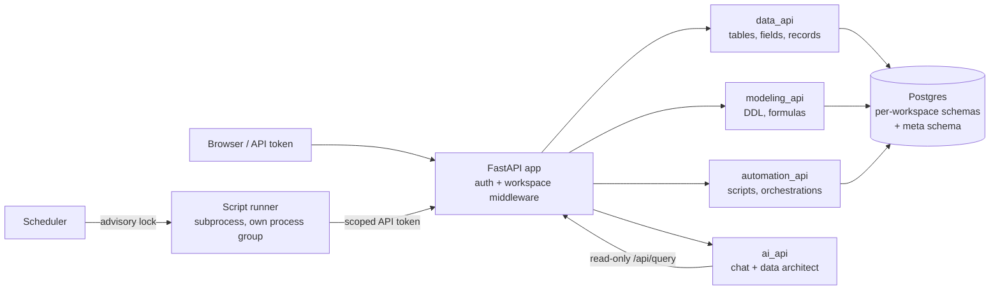

# Rownest

A multi-tenant, AI-native operations platform over Postgres. I designed and built it as a personal project, using Claude Code as my main tool for writing code.

> **The source is private.** This repo is the case study: what it does, how it is put together, and a few short excerpts of code I wrote. I am happy to walk through the real thing on a call, or to give read access to the repository during an interview.

## The idea

Small businesses keep their operations in spreadsheets and scattered tools. Rownest puts that data in a real Postgres database and gives the team a friendly layer on top: tables, boards, forms, dashboards, and automations. An AI "data architect" turns plain-English requests ("add a status column to leads and a board grouped by it") into schema changes.

## What it does

- **Data modeling in plain English.** An AI data architect, run through the Claude Code CLI, proposes schema changes, formulas and views. Changes are applied as audited DDL.
- **Views and dashboards.** Table and kanban views, KPI cards, charts, and a chat box that answers questions about the data.
- **Code-first automations.** Scripts and an orchestrator with cron and interval triggers, stored in the platform. Scripts never get database credentials. They write back through an audited API using a scoped token.
- **Forms.** Structured capture forms, both inside the app and as shareable pages.
- **Multi-tenant workspaces.** Each workspace has its own members, roles, grants, scripts and credentials.
- **Audit log and RBAC.** Every change is recorded and attributed to a user. Roles are admin, editor and viewer, set per workspace.

It is in production behind one real client website, where it serves as the content management backend.

## Architecture

Each backend module owns one area (data, modeling, views, widgets, automation, AI, auth), which made it easy to hand separate areas to parallel Claude Code agents without them colliding.

### Tenant isolation

- Roles live on the workspace membership, not on the user. Being admin in one workspace says nothing about another.
- Grants, scripts, credentials, orchestrations and audit rows all carry a `workspace_id`.
- Workspace data is read through a dedicated Postgres role per workspace, so the database itself enforces the boundary, not just application code.
- API tokens can be scoped to specific schemas. A token whose scoping did not finish provisioning is rejected rather than falling back to wider access.
- Credentials are encrypted at rest.

### Automation safety

- A Postgres advisory lock stops a slow job from being started twice (`excerpts/job_runner_lock.py`).
- Each job has a timeout. On timeout the whole process group is killed, so headless browsers do not linger (`excerpts/job_timeout_killpg.py`).
- Jobs run incrementally with a watermark and hand off between steps through staging tables.

## Excerpts

| File | What it shows |
|---|---|
| [`job_runner_lock.py`](excerpts/job_runner_lock.py) | Advisory lock so a scheduled job never overlaps itself |
| [`job_timeout_killpg.py`](excerpts/job_timeout_killpg.py) | Subprocess timeout that kills the whole process tree |
| [`grid_query.py`](excerpts/grid_query.py) | Fast row counts on big tables, plus safe SQL-side sort and filter |

## How I built it with AI

I made the design calls: the data shape, tenant isolation, which things scripts may touch, and what gets audited. Claude Code wrote first drafts, repetitive multi-file changes, tests and docs, often with several agents working in parallel, one per area. I read the diffs, ran the smoke tests, and checked behavior on the production database, not only the local copy. Once, the two had silently drifted apart, which is why I check both.

## Honest status

- Personal project, one production deployment for a client website.
- Stack: Python, FastAPI, Postgres, Docker, GitHub Actions.
- A smoke-test suite covers login, CRUD, RBAC and audit. There is no large test suite or load testing.
- I have not published benchmarks for the grid query changes. The design goal was to avoid a full count on every page load; I have not measured the gain.

## Contact

Dioni Riesco, Lima, Peru. [LinkedIn](https://www.linkedin.com/in/driescov/) · dioni.riesco.v@uni.pe
